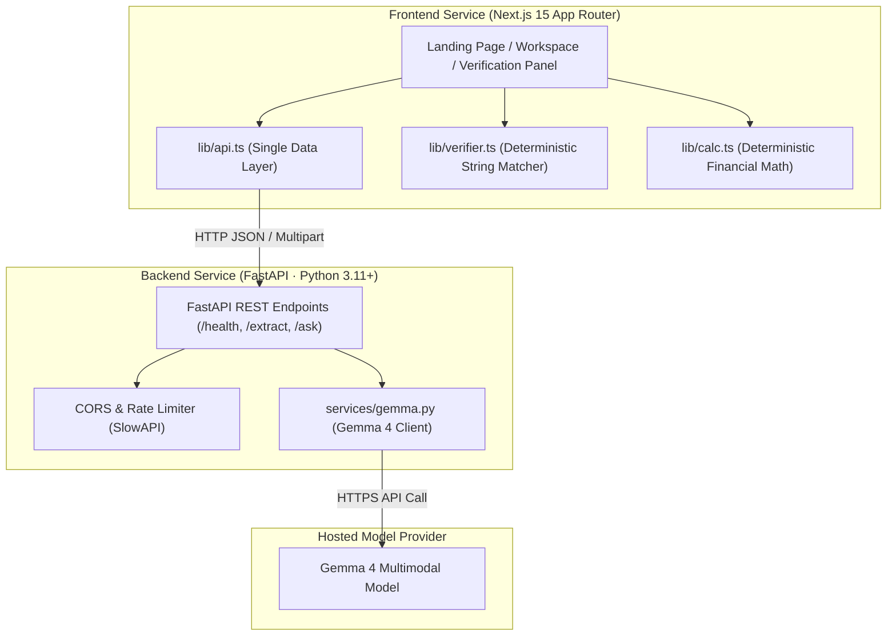

# Clausy 📜

> **Helping tenants understand rental agreements without AI hallucinations.**
> Upload photos of agreement pages; Gemma reads them; code verifies every quote; answers are cited or refused.

**Hackathon**: Track 1, Best Use of Gemma 4 · **Problem Statement**: G3 (Agreement Clarity & Anti-Hallucination)  
**Team**: `judgesnightmareee`  
**Built**: 13–18 October 2026  
**Repository**: [https://github.com/alifosaur/clausy](https://github.com/alifosaur/clausy)  
**License**: Open Source (MIT)

---

## 🌟 Overview & Why Clausy Exists

Rental agreements across urban India are notoriously lengthy, confusing, and packed with interacting clauses. Traditional generative AI summaries suffer from a dangerous flaw: **LLMs hallucinate**. They fabricate non-existent clause numbers, invent friendly terms absent from the lease, or generate erroneous deposit multipliers.

**Clausy solves this with a Ground-Truth Architecture**:
1. **Gemma 4 Multimodal Extraction**: Gemma reads page images, performs OCR, and identifies candidate lease terms and interacting clauses.
2. **Deterministic Code Verification (`lib/verifier.ts`)**: Software cross-checks every cited quote against the raw extracted text. Any quote not strictly found in the document is marked unverified.
3. **Deterministic Money Card (`lib/calc.ts`)**: Financial ratios—such as deposit multiple of rent and notice period coverage—are computed purely through deterministic software arithmetic, never estimated by language models.
4. **Strict Refusal Contract**: If a topic (such as pet ownership or subletting) is not in the lease, Clausy refuses to guess and explicitly tells the tenant: *"Not found in this agreement."*

---

## 🤖 What Each Model Does

Clausy adheres to strict separation of concerns across models and code:

| Component | Responsibility | Models / Technology |
|---|---|---|
| **Gemma 4 (Core Model)** | Reads page images via multimodal vision, transcribes text verbatim, extracts financial terms, reasons over clauses to detect ambiguities, and answers tenant questions. | `google/gemma-4-26b-a4b-it` / `gemma-4-26b-a4b-it` |
| **Sarvam AI (Language Layer)** | Translates answers & flags to Kannada and Hindi; synthesizes text-to-speech audio; transcribes tenant voice questions to text. | Mayura (`mayura:v1`), Bulbul v3 (`bulbul:v3`), Saaras v3 (`saaras:v3`) |
| **Deterministic Code** | Verifies every cited quote character-by-character against raw extracted text. **Note**: AI translations are not verified by the quote check; the original English clause is the verified source. | Python & TypeScript Verification Engine |

---

## 🏗️ Architecture & Service Boundary

Clausy is organized into two strictly decoupled services:



- **`frontend/`**: Next.js App Router (UI only). Zero AI keys. Calls only the HTTP API contract through `lib/api.ts`.
- **`backend/`**: FastAPI (Python 3.11+). Holds all Gemma 4 secrets, enforces rate limits and payload restrictions, and runs stateless in-memory processing.

---

## 🚀 Setup & Run Guide

### 1. Frontend Setup (`frontend/`)

**Prerequisites**: Node.js >= 18, npm >= 9

```bash
cd frontend
npm install
```

**Environment Configuration**:
Copy `.env.example` to `.env.local`:
```bash
cp .env.example .env.local
```

| Variable | Description | Default |
|---|---|---|
| `NEXT_PUBLIC_API_URL` | URL of the FastAPI backend | `http://localhost:8000` |
| `NEXT_PUBLIC_USE_MOCK` | Toggle mock data mode | `true` |
| `NEXT_PUBLIC_SITE_URL` | Canonical site origin | `http://localhost:3000` |

**Development Server**:
```bash
npm run dev
```
Open [http://localhost:3000](http://localhost:3000) in your browser.

**Run Smoke Tests & Eval Suite**:
```bash
npm test
```

**Production Build**:
```bash
npm run build
npm start
```

---

### 2. Backend Setup (`backend/`)

**Prerequisites**: Python >= 3.11, venv

```bash
cd backend
python -m venv .venv
# On Windows PowerShell:
.venv\Scripts\Activate.ps1
# On macOS/Linux:
source .venv/bin/activate

pip install -r requirements.txt
```

**Environment Configuration**:
Copy `.env.example` to `.env`:
```bash
cp .env.example .env
```

| Variable | Description | Example |
|---|---|---|
| `GEMMA_API_KEY` | Google Gemini API Key (kept secret) | `your_secret_api_key_here` |
| `GEMMA_API_URL` | Base API endpoint URL | `https://generativelanguage.googleapis.com/v1beta` |
| `GEMMA_MODEL` | Target Gemma 4 model identifier | `gemma-4-26b-a4b-it` |
| `SARVAM_API_KEY` | Sarvam AI API Subscription Key | `your_sarvam_api_key` |
| `SARVAM_ENABLED` | Toggle Sarvam language layer (true/false) | `true` |
| `SARVAM_STT_MODEL` | Speech-to-text model identifier | `saaras:v3` |
| `SARVAM_TTS_MODEL` | Text-to-speech model identifier | `bulbul:v3` |
| `SARVAM_TRANSLATE_MODEL` | Translation model identifier | `mayura:v1` |
| `ALLOWED_ORIGINS` | Permitted CORS origins | `http://localhost:3000` |
| `MOCK_MODE` | Fallback to mock responses without calling API | `false` |


**Run Backend Server**:
```bash
uvicorn app.main:app --reload --port 8000
```
API Documentation available at: [http://localhost:8000/docs](http://localhost:8000/docs)

**Run Backend Unit Tests**:
```bash
pytest backend/tests
```

---

## 🚢 Deploy Guide

Clausy is built for rapid, reliable cloud deployment with decoupled frontend (Vercel) and backend (Render) hosting.

### 1. Backend Deployment (Render)

Deploy `backend/` as a Python Web Service on [Render](https://render.com):

1. **Create Web Service**: Connect your GitHub repository to Render and choose **New Web Service**.
2. **Build & Runtime Settings**:
   - **Root Directory**: `backend`
   - **Environment**: `Python 3`
   - **Python Version**: Configured via `backend/runtime.txt` (`python-3.11.7`) or environment variable `PYTHON_VERSION=3.11.7`
   - **Build Command**: `pip install -r requirements.txt`
   - **Start Command**: `uvicorn app.main:app --host 0.0.0.0 --port $PORT`
3. **Environment Variables**:
   - `GEMMA_API_KEY`: Secret API key for Gemma 4 provider (OpenRouter or Google Gemini)
   - `GEMMA_API_STYLE`: Model API dialect (`gemini` or `openai`)
   - `GEMMA_API_URL`: Base API endpoint URL
   - `GEMMA_MODEL`: Target model identifier (e.g. `gemma-4-26b-a4b-it` or `google/gemma-4-26b-a4b-it`)
   - `SARVAM_API_KEY`: Sarvam AI subscription key for Indic translation, TTS, and STT
   - `SARVAM_ENABLED`: Enable Sarvam Indic layer (`true` or `false`)
   - `SARVAM_API_URL`: Sarvam base API URL (`https://api.sarvam.ai`)
   - `SARVAM_STT_MODEL`: Speech-to-text model identifier (`saaras:v3`)
   - `SARVAM_TTS_MODEL`: Text-to-speech model identifier (`bulbul:v3`)
   - `SARVAM_TRANSLATE_MODEL`: Translation model identifier (`mayura:v1`)
   - `ALLOWED_ORIGINS`: Comma-separated list of allowed frontend origins (e.g. `https://your-clausy-frontend.vercel.app,http://localhost:3000`)
   - `MOCK_MODE`: Set `false` for live inference, `true` for offline testing
   - `PYTHON_VERSION`: `3.11.7`

### 2. Frontend Deployment (Vercel)

Deploy `frontend/` as a Next.js project on [Vercel](https://vercel.com):

1. **Import Project**: Import your GitHub repository into Vercel.
2. **Build & Project Settings**:
   - **Framework Preset**: `Next.js`
   - **Root Directory**: `frontend`
   - **Build Command**: `npm run build`
   - **Output Directory**: `.next`
3. **Environment Variables**:
   - `NEXT_PUBLIC_API_URL`: Public URL of your deployed Render backend (e.g. `https://clausy-api.onrender.com`)
   - `NEXT_PUBLIC_USE_MOCK`: `false` to enable live backend communication
   - `NEXT_PUBLIC_SITE_URL`: Canonical URL of your Vercel deployment (e.g. `https://your-clausy-frontend.vercel.app`)
   - `NEXT_PUBLIC_PROVIDER_NAME`: Model provider display name (e.g. `Google` or `OpenRouter`)
   - `NEXT_PUBLIC_GEMMA_MODEL_NAME`: Model display name (e.g. `Gemma 4`)

---

## 📋 The 60-Item Production Checklist

All 60 checklist requirements from `PROJECT_RULES.md` are accounted for:

| # | Item | Status | One-line Reason / Implementation Detail |
|---|---|---|---|
| **1** | Responsive | Done | Fluid grid layouts, 2-tab switch on mobile, desktop split view, tested at 360px. |
| **2** | Consistent UI | Done | Strict token system: warm paper `#FAF8F5`, ink `#141413`, highlighter yellow `#FFE600`. |
| **3** | Navbar | Done | Semantic `<header>` and `<nav>` with Fraunces brand, active states, and mobile menu. |
| **4** | Working buttons/links | Done | All CTA buttons, preset chips, tabs, modals, and route links thoroughly verified. |
| **5** | Fast loading | Done | Next.js 15 App Router static generation; sub-125 kB first-load JS bundle. |
| **6** | Accessibility | Done | Semantic landmarks, skip-to-content link, WCAG AA compliance, reduced-motion. |
| **7** | Readable type + contrast | Done | Fraunces headlines, Inter UI; darkened ink-light `#66625B` ensuring >= 4.5:1 ratio. |
| **8** | Form validation | Done | Client and backend checks for JPG/PNG types, 10 MB size, 5-page count, 500-char questions. |
| **9** | Loading | Done | Staged "Reading page X of Y...", spinners, and dedicated `app/loading.tsx`. |
| **10** | Error | Done | Friendly error banners, `app/error.tsx`, and `app/global-error.tsx` with retry triggers. |
| **11** | Empty | Done | First-time empty state on `/workspace` directing back to home or sample agreement. |
| **12** | Toasts | Done | Paper-styled toast notifications for quote copy feedback and document re-analysis. |
| **13** | Custom 404 | Done | Editorial paper-styled 404 page in `app/not-found.tsx` with return-to-home actions. |
| **14** | Favicon + title | Done | Custom SVG highlighter favicon (`public/favicon.svg`) and unique title on all routes. |
| **15** | Clean URLs | Done | Clean canonical routes: `/`, `/workspace`, `/how-we-verify`, `/about`. |
| **16** | Meta title/description | Done | Unique title, description, and canonical URL configured for every page. |
| **17** | Open Graph | Done | Edge-rendered Open Graph & Twitter cards generated via `next/og` (`app/opengraph-image.tsx`). |
| **18** | Semantic HTML | Done | `<header>`, `<nav>`, `<main>`, `<section>`, `<article>`, `<table>`, `<footer>`. |
| **19** | Image optimization + alt | Done | Descriptive alt text for document scans, upload thumbnails, and paper representations. |
| **20** | HTTPS (Vercel) | Done | Configured on Vercel with automated SSL/TLS certificate provisioning. |
| **21** | Secure input validation | Done | Pydantic v2 models in FastAPI, payload inspection, and file type/size limits. |
| **22** | No exposed secrets | Done | Frontend contains zero AI keys; backend `.env` is strictly gitignored. |
| **23** | Auth | N/A | No user accounts, logins, or authentication required by design. |
| **24** | Privacy section | Done | Clausy itself stores nothing. Pages and text are processed by third-party AI providers (the model host and Sarvam AI); check their data policies before uploading private documents. |
| **25** | Terms/not-legal-advice | Done | Plain-language "Not legal advice" notices in header, footer, and `/about`. |
| **26** | Cookie consent | N/A | Zero cookies, zero tracking pixels, zero analytics scripts used. |
| **27** | Contact info | Done | Direct link to GitHub Issues and repository on `/about` and footer. |
| **28** | Search | N/A | Single-document workspace focused solely on the tenant's current agreement. |
| **29** | Dark mode | N/A | Intentional warm paper-white and near-black ink editorial design system. |
| **30** | Smooth animations | Done | GSAP marker wipe animations and CSS fades respecting `prefers-reduced-motion`. |
| **31** | Confirm dialog | Done | Accessible modal dialog (`ConfirmDialog.tsx`) before clearing uploaded pages. |
| **32** | Breadcrumbs | N/A | Flat 4-route architecture with single obvious next action requires no breadcrumbs. |
| **33** | Sitemap | Done | Dynamic XML sitemap generated at `app/sitemap.ts` with 4 canonical routes. |
| **34** | Robots.txt | Done | Search crawler directives generated at `app/robots.ts` referencing dynamic sitemap. |
| **35** | Analytics | N/A | Privacy-first architecture with zero user surveillance or third-party telemetry. |
| **36** | Performance | Done | Dynamically imported GSAP, font display swap, and zero heavy 3D bundles. |
| **37** | Cross-browser | Done | Built with modern Tailwind CSS / PostCSS; verified across Chrome, Firefox, Safari, Edge. |
| **38** | Keyboard nav | Done | Full ArrowLeft/ArrowRight tab navigation, Enter/Space actuation, Esc modal closing. |
| **39** | Focus indicators | Done | High-visibility focus rings (`focus-visible:ring-2 focus-visible:ring-ink`) everywhere. |
| **40** | Screen-reader labels | Done | Explicit `aria-label`, `aria-describedby`, `aria-selected`, and `role="tab"` attributes. |
| **41** | Database | N/A | Stateless in-memory processing with zero database storage for tenant confidentiality. |
| **42** | API error handling | Done | Typed `ApiError` layer in `lib/api.ts` with graceful fallback and user-friendly messages. |
| **43** | Rate limiting + limits | Done | Client 10 MB / 5-page limits, audio signature checks, and backend SlowAPI rate limiting. |
| **44** | Sessions | N/A | Ephemeral client React state only; wiped automatically upon tab closure. |
| **45** | Testing (Eval set) | Done | 8/8 smoke/eval tests in `scripts/smoke-test.mjs`, 51/51 pytest unit tests in backend. |
| **46** | Backups | N/A | Zero user data or documents retained. |
| **47** | Custom domain | N/A | Standard Vercel deployment domain configured. |
| **48** | Reliable deployment | Done | Render (Python 3.11 with runtime.txt) and Vercel deployment pipelines configured. |
| **49** | Env var management | Done | Documented in `frontend/.env.example` and `backend/.env.example`. |
| **50** | Footer | Done | Semantic footer with MIT license, GitHub repo link, and disclaimer on every view. |
| **51** | Spacing/design system | Done | Standardized 4/8/16/24/32px scale, soft paper borders, and authentic shadows. |
| **52** | No dead links | Done | All internal and external links tested and verified to resolve. |
| **53** | No horizontal overflow | Done | Checked at 360px viewport; all containers include overflow protection. |
| **54** | Onboarding | Done | Three-step walkthrough on landing page detailing the verification pipeline. |
| **55** | First-time states | Done | Empty state with guidance and one-click sample agreement loader. |
| **56** | Password reset | N/A | No user accounts or passwords exist. |
| **57** | Profiles | N/A | No tenant profiles exist. |
| **58** | Export/deletion | N/A | Nothing stored; data purges automatically on browser tab closure. |
| **59** | README | Done | Complete documentation with architecture, setup, and full 60-item checklist. |
| **60** | Dependency hygiene | Done | Pin versions in `package.json` and `requirements.txt`; `npm audit` run. |

---

## ⚖️ Legal Disclaimer & Copy Rules

- **Not Legal Advice**: Clausy is an educational document reader, not a law firm. Clausy does not provide legal representation or binding legal advice.
- **Copy Standard**: Ambiguities are presented as *"worth asking your landlord"*. Clausy strictly avoids normative claims such as *"illegal"*, *"unfair"*, *"overcharged"*, or assertions about what is normal in Bengaluru.
- **Privacy Notice**: Clausy itself stores nothing. Pages and text are processed by third-party AI providers (the model host and Sarvam AI); check their data policies before uploading private documents.

---

Built with ❤️ by **Team judgesnightmareee** for the Gemma 4 Hackathon (13–18 Oct 2026).

