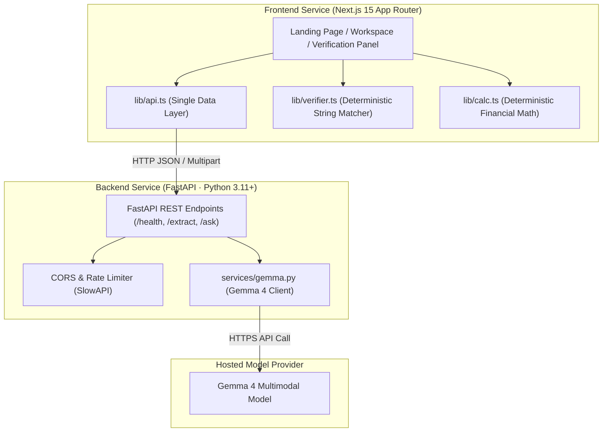

# Clausy 📜

> **Helping tenants understand rental agreements without AI hallucinations.**
> Upload photos of agreement pages; Gemma reads them; code verifies every quote; answers are cited or refused.

**Hackathon**: Track 1, Best Use of Gemma 4 · **Problem Statement**: G3 (Agreement Clarity & Anti-Hallucination)  
**Team**: `judgesnightmare`  
**Built**: 17–18 October 2026  
**Repository**: [https://github.com/alifosaur/clausy](https://github.com/alifosaur/clausy)  
**License**: Open Source (MIT)

---

## 🌟 Overview & Why Clausy Exists

Rental agreements across urban India are notoriously lengthy, confusing, and packed with interacting clauses. Traditional generative AI summaries suffer from a dangerous flaw: **LLMs hallucinate**. They fabricate non-existent clause numbers, invent friendly terms absent from the lease, or generate erroneous deposit multipliers.

**Clausy solves this with a Ground-Truth Architecture**:
1. **Gemma 4 Multimodal Extraction**: Gemma reads page images, performs OCR, and identifies candidate lease terms and interacting clauses.
2. **Deterministic Code Verification (`lib/verifier.ts`)**: Software cross-checks every cited quote against the raw extracted text. Any quote not strictly found in the document is marked unverified.
3. **Deterministic Money Card (`lib/calc.ts`)**: Financial ratios—such as deposit multiple of rent and notice period coverage—are computed purely through deterministic software arithmetic, never estimated by language models.
4. **Strict Refusal Contract**: If a topic (such as pet ownership or subletting) is not in the lease, Clausy refuses to guess and explicitly tells the tenant: *"Not found in this agreement."*

---

## 🤖 What Each Model Does

Clausy adheres to strict separation of concerns across models and code:

| Component | Responsibility | Models / Technology |
|---|---|---|
| **Gemma 4 (Core Model)** | Reads page images via multimodal vision, transcribes text verbatim, extracts financial terms, reasons over clauses to detect ambiguities, and answers tenant questions. | `google/gemma-4-26b-a4b-it` / `gemma-4-26b-a4b-it` |
| **Sarvam AI (Language Layer)** | Translates answers & flags to Kannada and Hindi; synthesizes text-to-speech audio; transcribes tenant voice questions to text. | Mayura (`mayura:v1`), Bulbul v3 (`bulbul:v3`), Saaras v3 (`saaras:v3`) |
| **Deterministic Code** | Verifies every cited quote character-by-character against raw extracted text. **Note**: AI translations are not verified by the quote check; the original English clause is the verified source. | Python & TypeScript Verification Engine |

---

## 🏗️ Architecture & Service Boundary

Clausy is organized into two strictly decoupled services:



- **`frontend/`**: Next.js App Router (UI only). Zero AI keys. Calls only the HTTP API contract through `lib/api.ts`.
- **`backend/`**: FastAPI (Python 3.11+). Holds all Gemma 4 secrets, enforces rate limits and payload restrictions, and runs stateless in-memory processing.

---

## 🚀 Setup & Run Guide

### 1. Frontend Setup (`frontend/`)

**Prerequisites**: Node.js >= 18, npm >= 9

```bash
cd frontend
npm install
```

**Environment Configuration**:
Copy `.env.example` to `.env.local`:
```bash
cp .env.example .env.local
```

| Variable | Description | Default |
|---|---|---|
| `NEXT_PUBLIC_API_URL` | URL of the FastAPI backend | `http://localhost:8000` |
| `NEXT_PUBLIC_USE_MOCK` | Toggle mock data mode | `true` |
| `NEXT_PUBLIC_SITE_URL` | Canonical site origin | `http://localhost:3000` |

**Development Server**:
```bash
npm run dev
```
Open [http://localhost:3000](http://localhost:3000) in your browser.

**Run Smoke Tests & Eval Suite**:
```bash
npm test
```
*Note: `scripts/smoke-test.mjs` checks standalone copies of the verification and calculation logic rather than the bundled React frontend.*

**Production Build**:
```bash
npm run build
npm start
```

---

### 2. Backend Setup (`backend/`)

**Prerequisites**: Python >= 3.11, venv

```bash
cd backend
python -m venv .venv
# On Windows PowerShell:
.venv\Scripts\Activate.ps1
# On macOS/Linux:
source .venv/bin/activate

pip install -r requirements.txt
```

**Environment Configuration**:
Copy `.env.example` to `.env`:
```bash
cp .env.example .env
```

| Variable | Description | Example |
|---|---|---|
| `GEMMA_API_KEY` | Google Gemini API Key (kept secret) | `your_secret_api_key_here` |
| `GEMMA_API_URL` | Base API endpoint URL | `https://generativelanguage.googleapis.com/v1beta` |
| `GEMMA_MODEL` | Target Gemma 4 model identifier | `gemma-4-26b-a4b-it` |
| `SARVAM_API_KEY` | Sarvam AI API Subscription Key | `your_sarvam_api_key` |
| `SARVAM_ENABLED` | Toggle Sarvam language layer (true/false) | `true` |
| `SARVAM_STT_MODEL` | Speech-to-text model identifier | `saaras:v3` |
| `SARVAM_TTS_MODEL` | Text-to-speech model identifier | `bulbul:v3` |
| `SARVAM_TRANSLATE_MODEL` | Translation model identifier | `mayura:v1` |
| `ALLOWED_ORIGINS` | Permitted CORS origins | `http://localhost:3000` |
| `MOCK_MODE` | Fallback to mock responses without calling API | `false` |


**Run Backend Server**:
```bash
uvicorn app.main:app --reload --port 8000
```
API Documentation available at: [http://localhost:8000/docs](http://localhost:8000/docs)

**Run Backend Unit Tests**:
```bash
pytest backend/tests
```

---

## 🚢 Deploy Guide

Clausy is built for rapid, reliable cloud deployment with decoupled frontend (Vercel) and backend (Render) hosting.

### 1. Backend Deployment (Render)

Deploy `backend/` as a Python Web Service on [Render](https://render.com):

1. **Create Web Service**: Connect your GitHub repository to Render and choose **New Web Service**.
2. **Build & Runtime Settings**:
   - **Root Directory**: `backend`
   - **Environment**: `Python 3`
   - **Python Version**: Configured via `backend/runtime.txt` (`python-3.11.7`) or environment variable `PYTHON_VERSION=3.11.7`
   - **Build Command**: `pip install -r requirements.txt`
   - **Start Command**: `uvicorn app.main:app --host 0.0.0.0 --port $PORT`
3. **Environment Variables**:
   - `GEMMA_API_KEY`: Secret API key for Gemma 4 provider (OpenRouter or Google Gemini)
   - `GEMMA_API_STYLE`: Model API dialect (`gemini` or `openai`)
   - `GEMMA_API_URL`: Base API endpoint URL
   - `GEMMA_MODEL`: Target model identifier (e.g. `gemma-4-26b-a4b-it` or `google/gemma-4-26b-a4b-it`)
   - `SARVAM_API_KEY`: Sarvam AI subscription key for Indic translation, TTS, and STT
   - `SARVAM_ENABLED`: Enable Sarvam Indic layer (`true` or `false`)
   - `SARVAM_API_URL`: Sarvam base API URL (`https://api.sarvam.ai`)
   - `SARVAM_STT_MODEL`: Speech-to-text model identifier (`saaras:v3`)
   - `SARVAM_TTS_MODEL`: Text-to-speech model identifier (`bulbul:v3`)
   - `SARVAM_TRANSLATE_MODEL`: Translation model identifier (`mayura:v1`)
   - `ALLOWED_ORIGINS`: Comma-separated list of allowed frontend origins (e.g. `https://your-clausy-frontend.vercel.app,http://localhost:3000`)
   - `MOCK_MODE`: Set `false` for live inference, `true` for offline testing
   - `PYTHON_VERSION`: `3.11.7`

### 2. Frontend Deployment (Vercel)

Deploy `frontend/` as a Next.js project on [Vercel](https://vercel.com):

1. **Import Project**: Import your GitHub repository into Vercel.
2. **Build & Project Settings**:
   - **Framework Preset**: `Next.js`
   - **Root Directory**: `frontend`
   - **Build Command**: `npm run build`
   - **Output Directory**: `.next`
3. **Environment Variables**:
   - `NEXT_PUBLIC_API_URL`: Public URL of your deployed Render backend (e.g. `https://clausy-api.onrender.com`)
   - `NEXT_PUBLIC_USE_MOCK`: `false` to enable live backend communication
   - `NEXT_PUBLIC_SITE_URL`: Canonical URL of your Vercel deployment (e.g. `https://your-clausy-frontend.vercel.app`)
   - `NEXT_PUBLIC_PROVIDER_NAME`: Model provider display name (e.g. `Google` or `OpenRouter`)
   - `NEXT_PUBLIC_GEMMA_MODEL_NAME`: Model display name (e.g. `Gemma 4`)

---

## 🗺️ Roadmap

- **Accounts and Authentication**: Optional tenant profiles to securely save, organize, and compare rental agreements across multiple tenancies.
- **Dark Mode**: High-contrast dark theme calibrated for night-time reading while maintaining the editorial warmth.
- **Real-Tenant Validation**: Field-testing and usability feedback sessions with active Bengaluru and Indian tenants reviewing live rental agreements.
- **Human-Checked Reading Accuracy Study**: Formal empirical benchmark measuring Gemma 4's verbatim transcription and numeric clause extraction accuracy against human legal auditor ground truth on 100+ multi-page Indian leases.

---

## ⚖️ Legal Disclaimer & Copy Rules

- **Not Legal Advice**: Clausy is an educational document reader, not a law firm. Clausy does not provide legal representation or binding legal advice.
- **Copy Standard**: Ambiguities are presented as *"worth asking your landlord"*. Clausy strictly avoids normative claims such as *"illegal"*, *"unfair"*, *"overcharged"*, or assertions about what is normal in Bengaluru.
- **Privacy Notice**: Clausy itself stores nothing. Pages and text are processed by third-party AI providers (the model host and Sarvam AI); check their data policies before uploading private documents.

---

Built with ❤️ by **Judgesnightmare** for the Gemma 4 Hackathon (13–18 Oct 2026).

